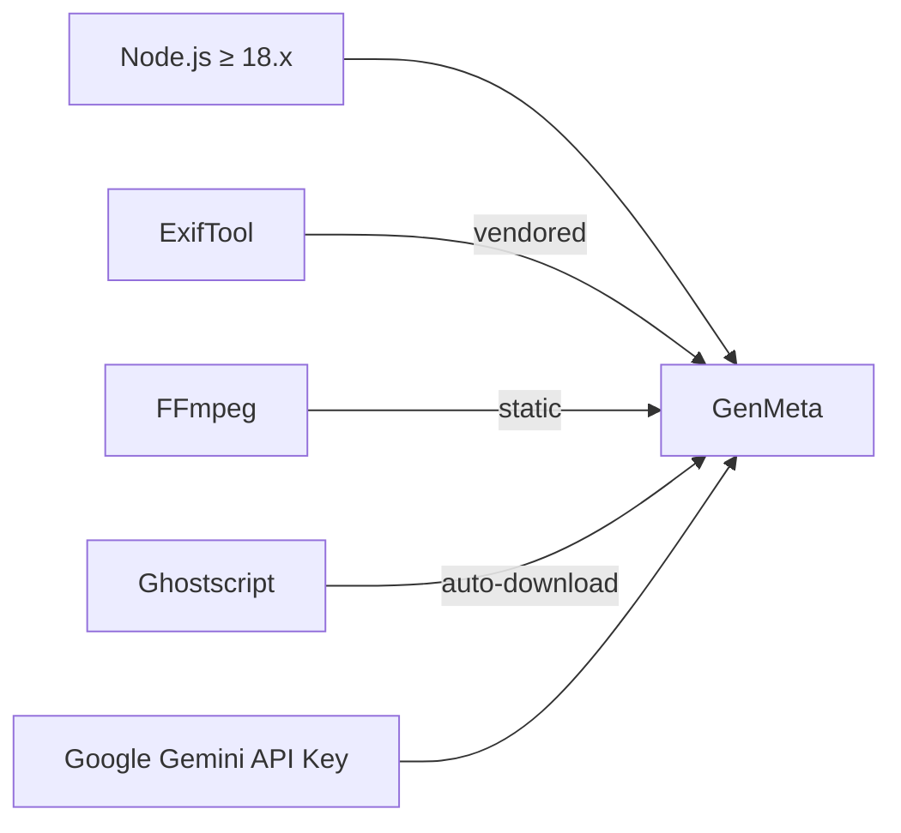
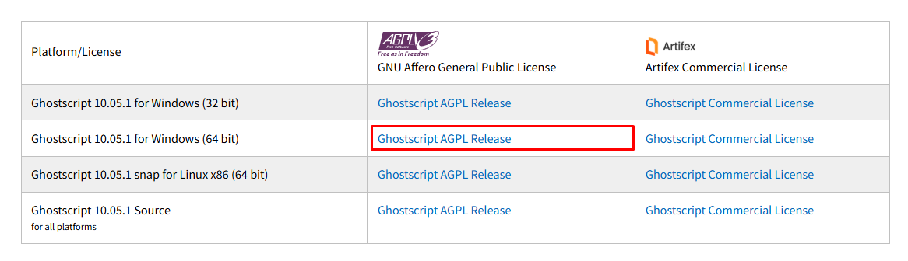

<p align="center">
  
</p>

<h1 align="center">
  ⚡ GenMeta <sub><sup>v6.5.10</sup></sub>
</h1>

<p align="center">
  <em>AI-Powered Metadata Generator for Microstock Contributors</em>
</p>

<p align="center">
  <a href="https://github.com/lazimmridha9-rgb/GEN-META-CR-BY_LAZIM/releases">
    
  </a>
  <a href="https://github.com/lazimmridha9-rgb/GEN-META-CR-BY_LAZIM/commits/main">
    
  </a>
  <a href="https://github.com/lazimmridha9-rgb/GEN-META-CR-BY_LAZIM/blob/main/GenMeta_Source_Full/LICENSE">
    
  </a>
  <a href="https://www.electronjs.org/">
    
  </a>
  <a href="https://ai.google.dev/">
    
  </a>
  <br/>
  <a href="https://github.com/lazimmridha9-rgb/GEN-META-CR-BY_LAZIM">
    
  </a>
  <a href="https://github.com/lazimmridha9-rgb/GEN-META-CR-BY_LAZIM/issues">
    
  </a>
  <a href="https://github.com/lazimmridha9-rgb/GEN-META-CR-BY_LAZIM/network">
    
  </a>
  <a href="#">
    
  </a>
  <a href="#">
    
  </a>
</p>

<p align="center">
  <a href="#-features">Features</a> •
  <a href="#-installation">Installation</a> •
  <a href="#-usage-guide">Usage</a> •
  <a href="#-screenshots">Screenshots</a> •
  <a href="#-project-structure">Structure</a> •
  <a href="#-technologies">Tech Stack</a> •
  <a href="#-configuration">Config</a> •
  <a href="#-faq">FAQ</a> •
  <a href="#-roadmap">Roadmap</a> •
  <a href="#-contributing">Contributing</a> •
  <a href="#-license">License</a>
</p>

<br/>

---

<br/>

## 📖 Overview

**GenMeta** is a desktop application that harnesses **Google Gemini AI** to automatically generate SEO-optimized metadata — **titles, descriptions, keywords, and categories** — for images and videos. Built specifically for **microstock contributors**, it writes metadata directly into **EXIF / XMP / IPTC** fields and exports platform-ready CSV files for:

<p align="center">
  &nbsp;&nbsp;
  &nbsp;&nbsp;
  &nbsp;&nbsp;
  &nbsp;&nbsp;
  &nbsp;&nbsp;
  &nbsp;&nbsp;
  &nbsp;&nbsp;
  
</p>

> Say goodbye to hours of manual keywording. GenMeta processes **hundreds of files** in a single batch with intelligent API key rotation and automatic retry logic.

<br/>

---

<br/>

## ✨ Features

### 🤖 AI Engine
| Capability | Details |
|:-----------|:--------|
| **Multimodal Analysis** | Gemini AI analyzes image/video content visually — not just filenames |
| **Supported Models** | `gemini-3.1-flash-lite`, `gemini-3-flash`, `gemini-2.5-flash`, `gemini-2.5-flash-lite` |
| **Smart Prompting** | Adaptive prompts per media type (image vs video) with platform-specific categories |
| **JSON Validation** | Auto-repairs malformed AI responses before processing |

### 🏷 Metadata Writing
| Field | Standard | Written Via |
|:------|:---------|:------------|
| Title | IPTC + XMP | ExifTool |
| Description | IPTC + XMP + EXIF | ExifTool |
| Keywords | IPTC + XMP | ExifTool |
| Categories | Platform-specific | ExifTool + CSV |

### 📁 File Support
| Type | Formats | Notes |
|:-----|:--------|:------|
| 🖼 **Images** | JPG, JPEG, PNG, GIF, BMP, WebP | Smart resize before AI analysis |
| 🎬 **Videos** | MP4, MOV, AVI, MKV, WebM | Frame extraction via FFmpeg |
| 🎨 **Vector** | EPS, SVG | Ghostscript auto-convert to raster |

### ⚡ Processing Pipeline
- **Batch orchestration** with configurable concurrency (default: 5 parallel requests)
- **API key rotation** across multiple keys for rate-limit avoidance
- **Intelligent retry** with exponential backoff
- **Progress tracking** with real-time UI updates
- **Temporary file cleanup** (EPS/SVG conversions, video frames, processed images)
- **File renaming** based on AI-generated titles

### 📊 Export Support
| Platform | CSV Format | Editorial Support | Regional Config |
|:---------|:-----------|:-----------------|:----------------|
| Adobe Stock | ✅ | — | — |
| Shutterstock | ✅ | — | — |
| iStock | ✅ | ✅ | Artist name |
| Pond5 | ✅ | ✅ | — |
| 123RF | ✅ | — | Country code |
| Freepik | ✅ | — | — |
| Dreamstime | ✅ | — | — |
| Vecteezy | ✅ | — | — |

<br/>

---

<br/>

## 📦 Installation

### Prerequisites



| Dependency | Version | Included? |
|:-----------|:--------|:----------|
| [Node.js](https://nodejs.org) | ≥ 18.x | ❌ Required |
| [ExifTool](https://exiftool.org) | 35.13.1 (vendored) | ✅ Bundled |
| [FFmpeg](https://ffmpeg.org) | 5.2.0 (static) | ✅ Bundled |
| [Ghostscript](https://ghostscript.com) | 10.x | ⬇️ Auto-downloaded |
| [Google Gemini API Key](https://ai.google.dev/) | — | ❌ Required (user-provided) |

### Setup

<details>
<summary><b>Windows</b> (click to expand)</summary>

```powershell
# Clone the repository
git clone https://github.com/lazimmridha9-rgb/GEN-META-CR-BY_LAZIM.git
cd GEN-META-CR-BY_LAZIM/GenMeta_Source_Full

# Install dependencies
npm install

# Launch GenMeta
npm start
```

**Quick launch:** Double-click `run_genmeta.cmd`
</details>

<details>
<summary><b>macOS / Linux</b> (click to expand)</summary>

```bash
# Clone the repository
git clone https://github.com/lazimmridha9-rgb/GEN-META-CR-BY_LAZIM.git
cd GEN-META-CR-BY_LAZIM/GenMeta_Source_Full

# Install dependencies
npm install

# Launch GenMeta
npm start
```
</details>

<br/>

---

<br/>

## 🚀 Usage Guide

<table>
<tr>
<td width="50%" valign="top">

### 1️⃣ Select Media
- Click **"Browse"** to pick a folder
- Supported: JPG, PNG, MP4, MOV, EPS, SVG
- Files are scanned and sorted automatically

</td>
<td width="50%" valign="top">

### 2️⃣ Configure
| Parameter | Options |
|:----------|:--------|
| Platform | Adobe Stock / Shutterstock / iStock / Pond5 / 123RF / General |
| Title Length | Short / Medium / Long |
| Keyword Count | 10 – 50 |
| Keyword Format | Single / Double / Auto |

</td>
</tr>
<tr>
<td width="50%" valign="top">

### 3️⃣ Generate
- Click **"Generate Metadata"**
- AI analyzes each file visually
- Metadata written to EXIF/XMP/IPTC in real time
- Progress bar shows live status

</td>
<td width="50%" valign="top">

### 4️⃣ Export & Rename
| Action | Details |
|:-------|:--------|
| 📄 **CSV Export** | Format per platform (Adobe, SS, iStock, Pond5, 123RF) |
| 🏷 **File Rename** | Auto-rename using AI titles |
| 🔁 **Retry** | Re-process individual files or full batch |
| 👁 **Preview** | Inspect metadata before export |

</td>
</tr>
</table>

<br/>

---

<br/>

## 🖼 Screenshots

<details open>
<summary><b>Application Preview</b></summary>

<br/>

| Main Dashboard | Batch Processing |
|:--------------:|:----------------:|
|  |  |

| CSV Export Dialog | Settings Panel |
|:-----------------:|:--------------:|
|  |  |

</details>

<br/>

---

<br/>

## 📁 Project Structure

```
📦 GEN-META-CR-BY_LAZIM
 ┣━ 📂 GenMeta_Source_Full               # Root source directory
 ┃ ┣━ 📂 src                              # Application source code
 ┃ ┃ ┣━ 📂 main                           # Electron main process
 ┃ ┃ ┃ ┣━ 📜 index.js                     # Entry point
 ┃ ┃ ┃ ┣━ 📜 preload.js                   # Context bridge (contextBridge + ipcRenderer)
 ┃ ┃ ┃ ┣━ 📜 window.js                    # Window management (persistent state)
 ┃ ┃ ┃ ┣━ 📂 ipc/                         # IPC handlers (11 modules)
 ┃ ┃ ┃ ┃ ┣── settings.ipc.js              # Settings read/write
 ┃ ┃ ┃ ┃ ┣── auth.ipc.js                  # Authentication
 ┃ ┃ ┃ ┃ ┣── processing.ipc.js            # Processing pipeline
 ┃ ┃ ┃ ┃ ┣── export.ipc.js                # CSV export
 ┃ ┃ ┃ ┃ ┣── rename.ipc.js                # File renaming
 ┃ ┃ ┃ ┃ ┣── ghostscript.ipc.js           # Ghostscript management
 ┃ ┃ ┃ ┃ ┣── update.ipc.js                # Auto-updater
 ┃ ┃ ┃ ┃ ┣── api-key.ipc.js               # API key validation
 ┃ ┃ ┃ ┃ ┣── directory.ipc.js             # Directory operations
 ┃ ┃ ┃ ┃ ┣── utilities.ipc.js             # Utility functions
 ┃ ┃ ┃ ┃ ┗── app.ipc.js                   # App-level operations
 ┃ ┃ ┃ ┗━ 📂 handlers/                    # Processing pipeline handlers
 ┃ ┃ ┃     ┣── submit.handler.js
 ┃ ┃ ┃     ┣── regenerate.handler.js
 ┃ ┃ ┃     ┣── rename.handler.js
 ┃ ┃ ┃     ┣── abort.handler.js
 ┃ ┃ ┃     ┣── key-management.handler.js
 ┃ ┃ ┃     ┗── progress.handler.js
 ┃ ┃ ┣━ 📂 renderer                       # Frontend UI
 ┃ ┃ ┃ ┣━ 📂 js/                          # Renderer scripts
 ┃ ┃ ┃ ┃ ┣── script.js                    # Main renderer (~8,288 lines)
 ┃ ┃ ┃ ┃ ┣── settings-sync.js             # Settings synchronization
 ┃ ┃ ┃ ┃ ┣── custom-dropdown.js           # Custom dropdown components
 ┃ ┃ ┃ ┃ ┣── ghostscript-installer.js     # GS installer UI logic
 ┃ ┃ ┃ ┃ ┣── api-key-manager.js           # API key management UI
 ┃ ┃ ┃ ┃ ┣── important-notes.js           # Important notes modal
 ┃ ┃ ┃ ┃ ┗── html-loader.js               # HTML partial loader
 ┃ ┃ ┃ ┣━ 📂 css/                         # ~61 stylesheets
 ┃ ┃ ┃ ┣━ 📂 html/                        # HTML partials & modals
 ┃ ┃ ┃ ┣━ 📂 assets/                      # Icons & images
 ┃ ┃ ┃ ┃ ┣━ 📂 icons/                     # Platform icons (SVG/PNG/WebP)
 ┃ ┃ ┃ ┃ ┗━ 📂 images/                    # App imagery
 ┃ ┃ ┃ ┗━ 📜 index.html                   # Main HTML shell
 ┃ ┃ ┣━ 📂 modules                        # Core business logic
 ┃ ┃ ┃ ┣━ 📂 ai/                          # Gemini AI integration
 ┃ ┃ ┃ ┃ ┣── client.js                    # AI client with retry + rotation
 ┃ ┃ ┃ ┃ ┣── error.js                     # AI error handling
 ┃ ┃ ┃ ┃ ┗━ 📂 prompt/                    # Prompt templates & builders
 ┃ ┃ ┃ ┃     ┣── templates.js             # Image & video prompt templates
 ┃ ┃ ┃ ┃     ┣── builder.js              # Dynamic prompt builder
 ┃ ┃ ┃ ┃     ┣── categories.js            # Adobe + Shutterstock categories
 ┃ ┃ ┃ ┃     ├── format.js               # Category format helpers
 ┃ ┃ ┃ ┃     ├── keywords.js             # Keyword prompt + forbidden list
 ┃ ┃ ┃ ┃     ┗── index.js                # Prompt module index
 ┃ ┃ ┃ ┣━ 📂 auth/                        # Authentication
 ┃ ┃ ┃ ┃   ├── auth.js                    # Auth service
 ┃ ┃ ┃ ┃   ├── store.js                   # Auth state store
 ┃ ┃ ┃ ┃   ├── client.js                  # Auth API client
 ┃ ┃ ┃ ┃   └── google.js                  # Google OAuth handler
 ┃ ┃ ┃ ┣━ 📂 media/                       # Media handling
 ┃ ┃ ┃ ┃   ├── image.js                   # Image prep + resize
 ┃ ┃ ┃ ┃   ├── video.js                   # Video frame extraction
 ┃ ┃ ┃ ┃   ├── format.js                  # Format detection
 ┃ ┃ ┃ ┃   ├── mime.js                    # MIME type helpers
 ┃ ┃ ┃ ┃   └── eps-svg.js                # EPS/SVG conversion
 ┃ ┃ ┃ ┣━ 📂 metadata/                    # Metadata management
 ┃ ┃ ┃ ┃   ├── generator.js              # Metadata generation
 ┃ ┃ ┃ ┃   ├── reader.js                  # EXIF reading
 ┃ ┃ ┃ ┃   ├── writer.js                  # EXIF/XMP/IPTC writing
 ┃ ┃ ┃ ┃   ├── eps-writer.js             # EPS metadata writer
 ┃ ┃ ┃ ┃   ├── json-repair.js            # AI response repair
 ┃ ┃ ┃ ┃   └── validator.js              # Metadata validation
 ┃ ┃ ┃ ┣━ 📂 ghostscript/                 # Ghostscript management
 ┃ ┃ ┃ ┃   ├── detection.js              # GS detection
 ┃ ┃ ┃ ┃   ├── download.js               # GS downloader
 ┃ ┃ ┃ ┃   ├── installer.js              # GS installer
 ┃ ┃ ┃ ┃   ├── executor.js              # GS execution
 ┃ ┃ ┃ ┃   └── verification.js          # GS verification
 ┃ ┃ ┃ ┣━ 📂 processing/                  # Processing pipeline
 ┃ ┃ ┃ ┃   ├── orchestrator.js           # Pipeline orchestrator
 ┃ ┃ ┃ ┃   ├── batcher.js               # Batch management
 ┃ ┃ ┃ ┃   ├── key-rotator.js           # API key rotation
 ┃ ┃ ┃ ┃   ├── progress.js              # Progress tracking
 ┃ ┃ ┃ ┃   ├── sanitizer.js             # Metadata sanitization
 ┃ ┃ ┃ ┃   ├── renamer.js               # File renamer
 ┃ ┃ ┃ ┃   └── tracker.js               # Usage tracking
 ┃ ┃ ┃ ┣━ 📂 settings/                    # Settings management
 ┃ ┃ ┃ ┗━ 📂 tracking/                    # API key usage tracking
 ┃ ┃ ┣━ 📂 process                        # Processing pipeline (legacy)
 ┃ ┃ ┃ ┣── batch.js
 ┃ ┃ ┃ ┣── image.js
 ┃ ┃ ┃ ┣── single.js
 ┃ ┃ ┃ ┣── video.js
 ┃ ┃ ┃ ┣── gemini-upload.js
 ┃ ┃ ┃ ┣── metadata-writer.js
 ┃ ┃ ┃ ┗── validator.js
 ┃ ┃ ┣━ 📂 services                       # API services
 ┃ ┃ ┃   ├── authService.js              # Auth API
 ┃ ┃ ┃   ├── guestAuth.js                # Guest session
 ┃ ┃ ┃   ├── updateService.js            # Auto-update (GitHub releases)
 ┃ ┃ ┃   ├── subscriptionService.js      # Subscription management
 ┃ ┃ ┃   └── startupService.js           # Startup checks
 ┃ ┃ ┣━ 📂 shared                         # Shared constants & helpers
 ┃ ┃ ┃   ├── formats.js                  # File format constants
 ┃ ┃ ┃   ├── mime.js                     # MIME type constants
 ┃ ┃ ┃   ├── csv-generators.js           # Platform CSV generators
 ┃ ┃ ┃   ├── json-helper.js             # JSON utilities
 ┃ ┃ ┃   └── mask-utils.js              # Mask utilities
 ┃ ┃ ┣━ 📂 config                         # Application configuration
 ┃ ┃ ┃   ├── api.js                      # API endpoints
 ┃ ┃ ┃   ├── app.js                      # App constants
 ┃ ┃ ┃   ├── constants.js               # Processing constants
 ┃ ┃ ┃   └── models.js                  # Supported AI models
 ┃ ┃ ┣━ 📂 utils                          # Utility functions
 ┃ ┃ ┣━ 📂 components                     # HTML component partials
 ┃ ┃ ┣━ 📂 modals                         # Modal dialog partials (13)
 ┃ ┃ ┣━ 📂 partials                       # Reusable HTML sections
 ┃ ┃ ┣━ 📂 sections                       # Main content sections
 ┃ ┃ ┗━ 📂 assets                         # App icons
 ┃ ┣━ 📜 package.json                     # Dependencies & metadata
 ┃ ┣━ 📜 package-lock.json                # Locked dependency versions
 ┃ ┣━ 📜 LICENSE                          # MIT License
 ┃ ┗━ 📜 run_genmeta.cmd                  # Windows launcher
 ┣━ 📜 run_genmeta.cmd                    # Root launcher
 ┣━ 📜 .gitignore                         # Git ignore rules
 ┗━ 📜 README.md                          # You are here 📖
```

<br/>

---

<br/>

## 🛠 Technologies

### Core Stack

<p align="center">
  <a href="https://www.electronjs.org/"></a>&nbsp;
  <a href="https://nodejs.org/"></a>&nbsp;
  <a href="https://ai.google.dev/"></a>
</p>

### Dependencies

| Package | Version | Purpose |
|:--------|:--------|:--------|
| **@google/genai** | ^1.34.0 | Google Gemini AI SDK |
| **exiftool-vendored** | ^35.13.1 | EXIF/XMP/IPTC metadata read/write |
| **sharp** | ^0.34.0 | Image processing (resize, format conversion) |
| **fluent-ffmpeg** | ^2.1.3 | Video frame extraction |
| **ffmpeg-static** | ^5.2.0 | Bundled FFmpeg binary |
| **ffprobe-static** | ^3.1.0 | Bundled FFprobe binary |
| **electron-updater** | ^6.6.2 | Auto-updates via GitHub releases |
| **electron-log** | ^5.3.3 | Application logging |

<br/>

---

<br/>

## ⚙️ Configuration

### Application Settings

Configuration files in `src/config/`:

```javascript
// src/config/api.js        — API endpoints (dev/staging/prod)
// src/config/app.js        — Timeouts, cleanup dirs, intervals
// src/config/constants.js  — Concurrency, retries, supported formats
// src/config/models.js     — Gemini AI model list
```

### Key Constants

| Constant | Value | Description |
|:---------|:------|:------------|
| `MAX_CONCURRENT_UPLOAD_REQUESTS` | 5 | Parallel AI requests |
| `MAX_RETRIES` | 1 | Retry attempts per file |
| `INITIAL_TIMEOUT` | 50,000ms | AI request timeout |
| `API_STATUS_CHECK_INTERVAL` | 10,000ms | Backend health check |
| `AUTH_TIMEOUT` | 5 min | Authentication window |

### Supported Gemini Models

| Model | Name |
|:------|:-----|
| 🚀 Fast | `gemini-3.1-flash-lite-preview` |
| ⚡ Balanced | `gemini-3-flash-preview` |
| 🌟 High Quality | `gemini-2.5-flash` |
| 💨 Light | `gemini-2.5-flash-lite` |

<br/>

---

<br/>

## ❓ FAQ

<details>
<summary><b>Do I need a Google Gemini API key?</b></summary>
Yes. GenMeta uses Google Gemini AI to analyze your media and generate metadata. You'll need a valid API key from <a href="https://ai.google.dev/">Google AI Studio</a>. Guest mode has limited functionality.
</details>

<details>
<summary><b>What file types are supported?</b></summary>
Images: JPG, JPEG, PNG, GIF, BMP, WebP<br/>
Videos: MP4, MOV, AVI, MKV, WebM<br/>
Vector: EPS, SVG (requires Ghostscript)<br/>
</details>

<details>
<summary><b>Does GenMeta modify my original files?</b></summary>
Yes — metadata is written directly into the file's EXIF/XMP/IPTC headers. The original pixel data is never altered. For safety, keep backups of your original files before batch processing.
</details>

<details>
<summary><b>How does Ghostscript get installed?</b></summary>
GenMeta auto-detects Ghostscript on your system. If not found, it downloads and installs it automatically (Windows only). macOS/Linux users should install Ghostscript via their package manager.
</details>

<details>
<summary><b>Can I use multiple API keys?</b></summary>
Yes — GenMeta supports API key rotation. Add multiple keys and the application will distribute requests across them to avoid rate limits.
</details>

<details>
<summary><b>Is there a subscription fee?</b></summary>
GenMeta offers both guest and authenticated (subscription-based) tiers. The subscription unlocks premium features like higher batch limits, priority processing, and advanced export options.
</details>

<br/>

---

<br/>

## 🗺 Roadmap

- [x] Core AI metadata generation (images & videos)
- [x] Batch processing with parallel execution
- [x] EXIF/XMP/IPTC metadata writing
- [x] EPS/SVG conversion & metadata support
- [x] Multi-platform CSV export
- [ ] Web version (cloud-based processing)
- [ ] Adobe Stock API direct submission
- [ ] Shutterstock API direct submission
- [ ] AI model fine-tuning for stock-specific keywords
- [ ] Bulk upload to multiple platforms simultaneously
- [ ] Plugin system for custom metadata workflows
- [ ] Linux ARM64 support

<br/>

---

<br/>

## 🔧 Troubleshooting

| Issue | Solution |
|:------|:---------|
| **Ghostscript not found** | Run the auto-installer from the UI, or manually install Ghostscript 10.x |
| **API timeouts** | Reduce `MAX_CONCURRENT_UPLOAD_REQUESTS` in `src/config/constants.js` |
| **Metadata not writing** | Verify ExifTool permissions — run as administrator if needed |
| **Large batches failing** | Decrease batch size or increase `INITIAL_TIMEOUT` in config |
| **EPS preview not generating** | Ensure Ghostscript is properly installed and on system PATH |
| **Video processing slow** | Reduce video resolution or shorten clip duration before processing |

<br/>

---

<br/>

## 🔧 Build & Development

```bash
# Clone and install
git clone https://github.com/lazimmridha9-rgb/GEN-META-CR-BY_LAZIM.git
cd GEN-META-CR-BY_LAZIM/GenMeta_Source_Full
npm install

# Run in development mode
npm start        # or: npx electron .

# For packaging with electron-builder:
# npx electron-builder --win    (Windows)
# npx electron-builder --mac    (macOS)
# npx electron-builder --linux  (Linux)
```

> ℹ️ GenMeta currently runs directly from source. Add `electron-builder` or `electron-forge` for packaged distribution builds.

<br/>

---

<br/>

## 🙏 Credits

<table>
<tr>
  <td><b>Original Author</b></td>
  <td><a href="https://github.com/aminurdev">Aminur Rahman</a></td>
</tr>
<tr>
  <td><b>Repository</b></td>
  <td><a href="https://github.com/lazimmridha9-rgb/GEN-META-CR-BY_LAZIM">GEN-META-CR-BY_LAZIM</a></td>
</tr>
<tr>
  <td><b>AI Engine</b></td>
  <td><a href="https://ai.google.dev/">Google Gemini AI</a></td>
</tr>
<tr>
  <td><b>Desktop Framework</b></td>
  <td><a href="https://www.electronjs.org/">Electron</a></td>
</tr>
<tr>
  <td><b>Metadata Toolkit</b></td>
  <td><a href="https://exiftool.org/">ExifTool</a> by Phil Harvey</td>
</tr>
<tr>
  <td><b>Image Processing</b></td>
  <td><a href="https://sharp.pixelplumbing.com/">Sharp</a></td>
</tr>
<tr>
  <td><b>Video Processing</b></td>
  <td><a href="https://ffmpeg.org/">FFmpeg</a></td>
</tr>
<tr>
  <td><b>Vector Conversion</b></td>
  <td><a href="https://ghostscript.com/">Ghostscript</a></td>
</tr>
</table>

<br/>

---

<br/>

## 📄 License

This project is licensed under the **MIT License** — see the [`LICENSE`](GenMeta_Source_Full/LICENSE) file for details.

```
MIT License
Copyright (c) 2024 Aminur Rahman
Permission is hereby granted, free of charge, to any person obtaining a copy
of this software and associated documentation files (the "Software"), to deal
in the Software without restriction, including without limitation the rights
to use, copy, modify, merge, publish, distribute, sublicense, and/or sell
copies of the Software, and to permit persons to whom the Software is
furnished to do so, subject to the following conditions:
...
```

<br/>

---

<br/>

<p align="center">
  
</p>

<p align="center">
  <b>⚡ GenMeta</b> — <i>Intelligent Metadata, Effortlessly Generated</i>
</p>

<p align="center">
  <a href="https://github.com/lazimmridha9-rgb/GEN-META-CR-BY_LAZIM">
    
  </a>
</p>

<p align="center">
  <sub>Built with ❤️ for microstock contributors worldwide</sub>
  <br/>
  <sub>© 2024 <a href="https://github.com/aminurdev">Aminur Rahman</a> &nbsp;·&nbsp; Maintained by <a href="https://github.com/lazimmridha9-rgb">lazimmridha9-rgb</a></sub>
</p>
